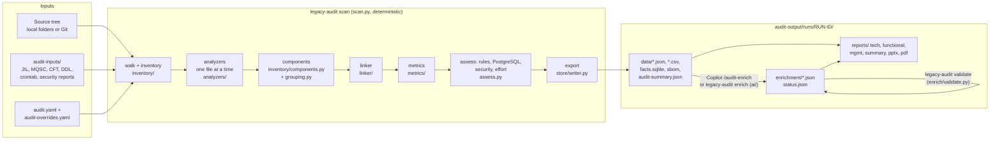

# Architecture and data flow

This page explains how `legacy-audit` is put together: what runs when, which module does it,
and what each step reads and writes. Names in `code` are real modules and functions; the
[module reference](reference/modules.md) lists every one of them with its signature.

## The big picture



Three rules shape everything (from `.github/copilot-instructions.md`):

1. **Scripts count, AI interprets.** The scan never calls a model. Every number in every output
   is computed by Python from the facts, and every fact carries `evidence: [{file, line}]`.
   The AI (Copilot or `legacy-audit enrich`) only writes words into `enrichment/`, and the
   validator rejects any number it writes that differs from the scan.
2. **Never write into the scanned source.** Everything goes to `audit-output/`.
3. **Re-runnable.** Each scan is a new folder `runs/<run-id>/`. Per-file analysis is cached;
   everything that crosses files (linking, metrics, rules, totals) is recomputed every run.

## Entry points

| How it starts | Code | What it calls |
| --- | --- | --- |
| `legacy-audit <command>` | `legacy_audit/cli.py` (Typer app `app`) | the functions below; see [reference/cli.md](reference/cli.md) |
| `python -m legacy_audit` | `legacy_audit/__main__.py` | same CLI |
| `legacy-audit serve` (GUI) | `legacy_audit/gui/app.py` `create_app` | the same functions as the CLI, in background jobs; see [reference/gui-api.md](reference/gui-api.md) |
| `legacy-audit mcp` (Copilot tools) | `legacy_audit/mcp/server.py` `Server` over `mcp/facts.py` `Facts` | reads `facts.sqlite` of the latest run |
| VS Code tasks | `.vscode/tasks.json` | the CLI and `scripts/show_*.py`; see [reference/vscode-tasks.md](reference/vscode-tasks.md) |

The CLI and the GUI hold no logic of their own: they load the config, call one function and
print or return the result.

| Command | Function |
| --- | --- |
| `init` | `workspace.init_workspace` (starter files) and `copilot.install.install` (Copilot files) |
| `scan` | `scan.run_scan` |
| `report --type tech` | `report.tech.build_tech_report` |
| `report --type functional` | `report.functional.build_functional_report` |
| `report --type mgmt` | `report.mgmt.build_mgmt_report` (HTML deck from `report.deck_builder.build_deck`) |
| `report --type pptx` | `report.pptx.build_pptx` (on a template, `report.pptx_build`) |
| `report --type summary` | `report.summary.build_summary_report` |
| `report --type pdf` | `report.pdf.build_pdfs` (prints the HTML reports with Edge/Chrome/Chromium) |
| `validate` | `enrich.validate.validate_run` |
| `enrich` | `ai.runner.enrich` with `ai.providers.Client` |
| `facts` | `mcp.facts.Facts.query_facts` |
| `diff` | `store.diff.diff_runs` |
| `doctor` | `doctor.run_checks` |
| `purge-cache` | `source.git.purge_cache` |

## Configuration

`config.load_config(path)` reads `audit.yaml` into `AuditConfig` (pydantic, `extra="forbid"`,
so a misspelt key is an error naming the key) and returns a `LoadedConfig` with the resolved
`base_dir`, `output_dir`, `inputs_dir`, `overrides_path` and a hash of the config. All keys are
listed in [reference/config.md](reference/config.md). `audit-overrides.yaml` (human corrections:
exclude/include files, assign/rename/retype components) is read by `overrides.load_overrides` and
re-applied on every run.

## The scan pipeline (`scan.run_scan`)

`run_scan` takes a lock on the output folder (`store/lock.py` `ScanLock`, one scan at a time),
removes run folders a previous scan left unfinished (no `run.json`), creates
`runs/<run-id>/logs/scan.log` (with `SecretFilter` masking Git tokens) and calls `_run`, whose
stages are below. Each stage time goes into `run.json > timings`. A `progress(stage, n, total)`
callback feeds the CLI progress bar and the GUI job events; a `cancel` event stops the scan
between files (`parallel.check`), and the unfinished run folder is removed.

### 1. Sources (`source/`)

`source.resolve_sources(loaded)` returns the roots to scan: the local `source.paths` (default
`.`) or Git repositories shallow-cloned into `~/.legacy-audit/cache` (`source/git.py`; the
token is read from the environment variable named in `token_env`, never stored). Each root has
a name; with several roots, file paths are prefixed with the root name.

### 2. Walk and inventory (`inventory/`)

- `inventory/walker.py` `walk` lists files honouring `include` / `exclude` (gitignore syntax via
  `pathspec`), the default excludes (VCS folders, IDE folders, `node_modules`, ...), and
  `inventory.skip_build_output` (compiled output and precompiler-generated files are left out
  and reported as `build-output-skipped` findings). Tool-owned paths (the output folder,
  `audit.yaml`, the Copilot files `init` installs: `scan.COPILOT_PATHS`) are never scanned.
  Files in `audit-inputs/` are walked too, with `origin: input`.
- The per-file cache (`inventory/cache.py` `FileCache`, SQLite in
  `audit-output/cache/file-cache.sqlite`) is checked first: a file whose size and mtime are
  unchanged is not read again. The cache key also holds `version_key(INVENTORY_VERSION)` (every
  analyzer's `name=version`), the binary and size settings, the duplication window size and a
  hash of the text rules. **Bumping an analyzer's `version` re-analyses every file it
  supports on the next run**; bumping `inventory/files.py` `INVENTORY_VERSION` re-reads every
  file.
- The rest go to a process pool (`parallel.ordered_map`, `inventory.workers`; results come back
  in walk order). Each worker runs `inventory/worker.py` `process(job)`:
  1. `inventory/files.py` `analyze_file`: SHA-256, encoding (`inventory/encoding.py`: UTF-8,
     EBCDIC, then `charset-normalizer`), language and category (`inventory/language.py`:
     extension, file name, then content sniffing), lines of code (`inventory/loc.py`). Binary
     files are detected by extension and content and get no LOC.
  2. Every registered analyzer whose `supports(record)` is true runs `analyze(record, ctx)` and
     returns a `Facts` (see below). An analyzer that raises becomes an `analyzer-error`
     finding and a coverage gap for that file (`worker.run_analyzer`); the scan goes on.
  3. The result (the `FileRecord` plus each analyzer's `Facts.dump()`) is stored in the cache.
- Files that cannot be read (permissions, long Windows paths) or are larger than
  `inventory.max_file_size_mb` become `file-unreadable` / `file-too-large` findings.

### 3. Analyzers (`analyzers/`)

An analyzer looks at **one file** and returns `analyzers.base.Facts`:

| Field | Holds |
| --- | --- |
| `entities` | `{entity name: [fact models]}`: services, screens, sql_statements, integrations, libraries, tech_stack, batch_jobs, db_objects, entry_points, web_services, findings, ... (models in `model/facts.py`) |
| `symbols` | `Symbol(kind, name, file, line, owner)`: what this file defines, findable by name (a class, a COBOL program, a copybook, a JCL procedure, a Struts action, a pom) |
| `refs` | `Ref(kind, source, target, target_kinds, file, line)`: what this file points at by name (calls, includes, forwards, invokes, ...); the linker resolves them |
| `coverage` | lines in the file and the regions the analyzer could not parse (`coverage.gap(start, end, reason)`) |
| `units`, `windows`, `hits` | code units with cyclomatic complexity, duplication windows, and text-rule hits (filled by the `metrics` and `patterns` analyzers) |

Analyzers never read other files and never touch the store, so their result can be cached per
file. All registered analyzers, in order, with their versions: [reference/analyzers.md](reference/analyzers.md).
Parsers: tree-sitter (Java, C, C++, TypeScript/JavaScript, C#), `sqlglot` (SQL), and
line-by-line readers with regular expressions for the rest (COBOL, JCL, shell, VB, JIL, MQSC,
...). Shared helpers: `analyzers/textutil.py` (`split_lines`: the one line-break rule),
`analyzers/integrations.py` (building `Integration` facts), `analyzers/dynsql.py` and
`analyzers/embedded.py` (SQL built at run time and `EXEC SQL` blocks), `analyzers/sqltools.py`
(SQL parsing with `sqlglot`).

### 4. Components (`inventory/components.py`, `inventory/grouping.py`, `overrides.py`)

`detect_components` decides which files belong to which component: from build files (Maven,
Gradle, Ant, Make, Eclipse, Visual Studio, npm, ...), else from the folder layout (decision 114).
Maven/Gradle parents and aggregators are groups, their modules are components (decision 166).
`grouping.py` then merges them per deployable (a library module joins the war/ear/batch jar that
uses it) or by technology when there is no build file (decision 176;
`inventory.component_grouping: module` turns this off). Components listed in `audit.yaml >
components` win. `overrides.apply_component_overrides` applies `audit-overrides.yaml` and records
in `run.json > overrides` how many items each override matched (unused ones become warnings).

### 5. Linker (`linker/`)

`linker.link(records, facts, copybook_paths, group_by_service)` (class `_Linker` in
`linker/link.py`) runs on all per-file facts together, every run:

1. **Merge** (`linker/aggregate.py`): the same library, tech item, integration, batch job, DB
   object or screen found in several files becomes one fact with all its evidence. Maven
   versions inherited from parents are resolved (`linker/maven.py`). Batch jobs become
   `batch-job` services.
2. **Resolve references**: each `Ref` is matched against symbols and file paths into a
   `CodeEdge` (`dependencies` entity). References that should resolve but do not become
   `unresolved-reference` findings and are counted in `run.json > unresolved_references`.
3. **Cross-link**: screens reached from services (screens vs partials), COBOL sub-programs
   pruned from the service count, SQL to tables (CRUD) and procedures, services to the tables
   and integrations they reach, batch jobs to components, every fact to its component.
4. **Web services** (`linker/websvc.py` `build_web_services`): one row per REST/SOAP service,
   offered or called, with its operations (decision 133).
5. **Group integrations by service** (`aggregate.group_by_service`, decision 177): one row per
   host, queue manager or file server.

A step that fails (web services, grouping) is logged and becomes a run warning; the rest of the
scan completes (decision 178). Then `classify_components` refines each component's `type` and
`roles` from what was found in it (decision 115).

### 6. Metrics (`metrics/`)

`metrics.compute.compute` builds per-component `Metric` facts from the cached code units and
windows: complexity per unit (`metrics/units.py`), duplication (`metrics/tokens.py`), fan-in
and fan-out, dead-code candidates, and complexity scores and bands (Simple, Medium, Complex,
Very complex) for services, screens and batch jobs, with the weights in `audit.yaml >
complexity`.

### 7. Assess (`assess.py`)

`assess.assess(...)` runs after metrics, on the linked facts:

- **PostgreSQL grades** (`legacy_audit/rules/pg.py` `grade_all`, rules in `rules/pg-rules.yaml`): each SQL
  statement and stored object gets `auto`, `review` or `manual` and, when it can, the suggested
  PostgreSQL text. Skipped with `target.profile: none`.
- **Dependency security** (`security/`): Dependency-Check / OSV-Scanner are run when installed
  or their JSON reports are imported from `audit-inputs/security/` (`security/vulns.py`), end
  of life (`security/eol.py`, `rules/eol.yaml`), upgrade advice
  (`security/upgrades.py`, `rules/dependency-upgrades.yaml`), optional `jdeps`/`jdeprscan`
  (`security/jdk.py`), and the CycloneDX SBOM (`security/sbom.py`).
- **Rules** (`legacy_audit/rules/engine.py`, packs loaded by `legacy_audit/rules/packs.py` from
  the repository's `rules/*.yaml` plus a team `rules.packs_dir`): fact rules over the linked facts and text rules from the cached
  hits become `Finding`s; `rules.disabled` and `rules.severity` are applied here.
- **Effort** (`metrics/effort.py`): person-days low/likely/high from `effort.weights`.
- **Target** (`target.py`): the migration target profile fills the `[[phrase]]` placeholders
  in finding texts and picks the rule-table entries for that target (decision 161).

### 8. Export (`store/`)

- `store.writer.drop_duplicate_ids` leaves out rows whose id is already used (with a warning).
- `store.writer.write_facts` writes, for every entity in `model.ENTITIES`, `data/<entity>.json`
  (source of truth), `data/<entity>.csv` and a table in `data/facts.sqlite`. Columns and types:
  [reference/entities.md](reference/entities.md).
- Also written: `data/sbom.cdx.json`, `data/effort.json`, `data/target-mapping.json`,
  `data/target.json`, `run.json` (`model.RunInfo`) and `data/audit-summary.json`
  (`store/summary.py` `build_summary`: totals and top-N lists under 30 KB for the AI's context;
  the headline counts come from `store/counts.py` `counts`, the one place counts are computed).
- `enrich.status.carry_over` copies the previous run's `enrichment/` into the new run and marks
  stages whose inputs changed as stale.
- `store.runs.set_latest` writes `runs/LATEST` and `runs/HISTORY` and points
  `audit-output/latest` at the run (a symlink, or a full copy on Windows without developer mode).

## A run folder

```
audit-output/
  cache/file-cache.sqlite         per-file results (kept between runs)
  latest -> runs/<run-id>         symlink, or a copy on Windows without symlinks
  runs/
    LATEST, HISTORY               newest run id; run ids in completion order
    <yyyymmdd-hhmmss-xxxxxx>/
      run.json                    RunInfo: config hash, sources, coverage, timings, warnings...
      logs/scan.log
      data/                       <entity>.json/.csv, facts.sqlite, audit-summary.json,
                                  sbom.cdx.json, effort.json, target-mapping.json, target.json
      security/                   reports written by the vulnerability scanners
      enrichment/                 <stage>.json (AI words), status.json
      reports/
        tech/  functional/  mgmt/  summary/  pdf/   deck.pptx
```

## Enrichment (the AI part)

Thirteen stages (overview, classification, architecture, flows, ...; table in
[reference/enrichment-stages.md](reference/enrichment-stages.md)) are defined in
`enrich/stages.py`, each with a pydantic model in `enrich/models.py` and a JSON Schema in
`schemas/enrichment/`.

- **Writing**: in VS Code, the `legacy-auditor` Copilot agent and `/audit-enrich` prompt (files
  in `legacy_audit/copilot/`, installed into the audited workspace by `legacy-audit init`) read
  the facts through `legacy-audit facts` or the MCP server and write
  `audit-output/latest/enrichment/<stage>.json`. From the command line, `legacy-audit enrich`
  (`ai/runner.py`) builds a prompt per stage (`ai/context.py`), calls the model chosen in
  `audit.yaml > ai` (`ai/providers.py`: OpenAI-compatible, Azure OpenAI, Anthropic, Ollama;
  standard library HTTP, key from an environment variable) and repairs errors the validator
  reports.
- **Checking**: `enrich/validate.py` `validate_run` checks schema, ids, numbers (each figure
  must equal the scan's value at its `metric` path, unless marked `estimate`) and evidence
  (file exists, line in range), then stamps `meta.built_from` with the hashes of the inputs.
- **Staleness**: `enrich/status.py` compares those hashes after each scan;
  `enrichment/status.json` lists missing, stale and valid stages.
- **Use**: the reports read the stage files (`report.deck_builder.load_enrichment`) and mark
  AI-written text "(AI)"; a missing stage shows a placeholder, never a made-up number.

## Reports (`report/`)

Every report reads one run folder through `report/data.py` `RunData` (run.json, data/*.json,
where the scanned files are so evidence can link to them) and only **displays** facts.

| Report | Builder | Output | Templates and assets |
| --- | --- | --- | --- |
| Technical site | `tech.build_tech_report` (class `_Pages`) | `reports/tech/` | Jinja2 pages in `report/tech_html/`, catalogues (`report/catalogues.py`) as `data/*.js`, `report/assets/` (report.js, report.css, vendored Chart.js and Mermaid) |
| Functional document | `functional.build_functional_report` (`_FnPages` extends `_Pages`) | `reports/functional/` | `tech_html/fn_*.html`; flows from `report/flows.py`, graphics from `report/visuals.py` |
| Management deck (HTML) | `mgmt.build_mgmt_report` | `reports/mgmt/` | slides as data from `deck_builder.build_deck` (`deck.json`), `mgmt_html/deck.html`, `mgmt_assets/` |
| PowerPoint | `pptx.build_pptx` | `reports/deck.pptx` | `pptx_build.build_on_template` on a corporate `.potx` from `templates/` (`pptx_templates.py`); Mermaid PNGs when `mmdc` is installed |
| Summary report | `summary.build_summary_report` (class `_Summary`) | `reports/summary/` (+ `summary.pptx`, CSVs) | `summary_html/summary.html`; five sections (`summary.SECTIONS`) |
| PDFs | `pdf.build_pdfs` | `reports/pdf/` | headless Edge/Chrome/Chromium prints the HTML; `pypdf` joins pages, adds contents and bookmarks |

Shared pieces: `report/batches.py` (one consolidated batch list), `report/servers.py`
(application servers table), `report/diagrams.py` (Mermaid from facts), `report/comments.py`
(header comments of source files). HTML reports work from `file://` with no network: no CDN,
vendored JS only.

## GUI (`gui/`)

`gui/app.py` `create_app(folder, port)` builds a FastAPI app bound to 127.0.0.1: a `Workspace`
(the folder with `audit.yaml`), routes for config, inputs, components, scans, runs, facts,
evidence, enrichment, reports and the doctor, and `gui/jobs.py` `Jobs` (one background job at a
time, progress as Server-Sent Events, cancel). The page is plain HTML/JS in `gui/static/` (no
build step). Security: Host must be localhost, changes need the `X-Legacy-Audit: 1` header,
paths are checked to stay inside the workspace and run folders.

## MCP server (`mcp/`)

`legacy-audit mcp` speaks JSON-RPC over stdio (no SDK dependency) and exposes read-only tools
over the latest run's `facts.sqlite`: `query_facts`, `get_component`, `get_sql`,
`read_evidence`, `coverage` (`mcp/server.py` `TOOLS`, implemented in `mcp/facts.py`). `init`
registers it for Copilot in `.vscode/mcp.json`.

## Two different sets of Copilot files

Do not mix them up:

| Files | Who reads them | Purpose |
| --- | --- | --- |
| `.github/copilot-instructions.md`, `.github/instructions/*.instructions.md` (this repository) | Copilot working **on this tool's code** | how to develop legacy-audit |
| `legacy_audit/copilot/` (`agent.md`, `copilot-instructions.md`, `prompts/*.prompt.md`, `mcp.json`) | Copilot in an **audited workspace**, after `legacy-audit init` copies them there | the product feature: the `legacy-auditor` agent and `/audit-*` prompts analysts use |

Changing the second set changes what analysts get; they pick it up by running
`legacy-audit init` again (`copilot/install.py` keeps their edits and writes `<file>.new`).
