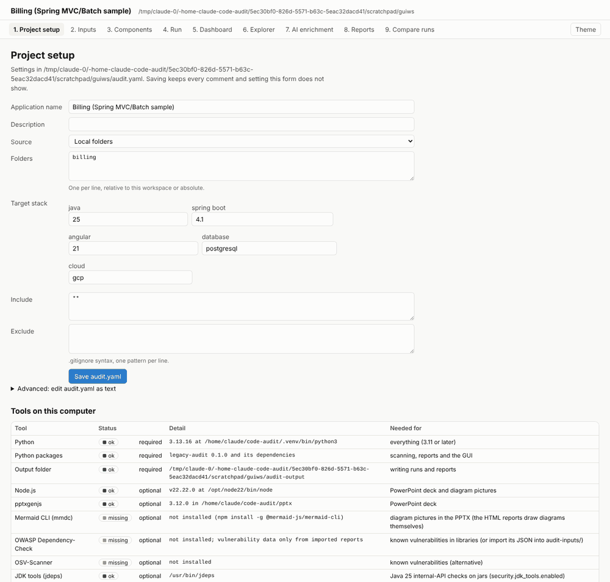
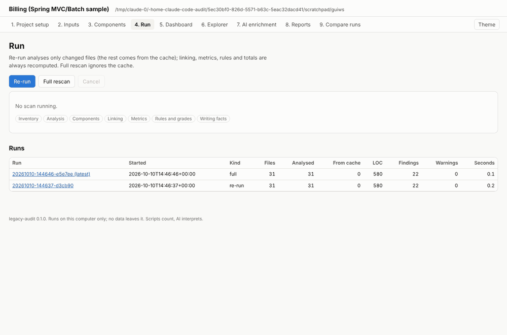
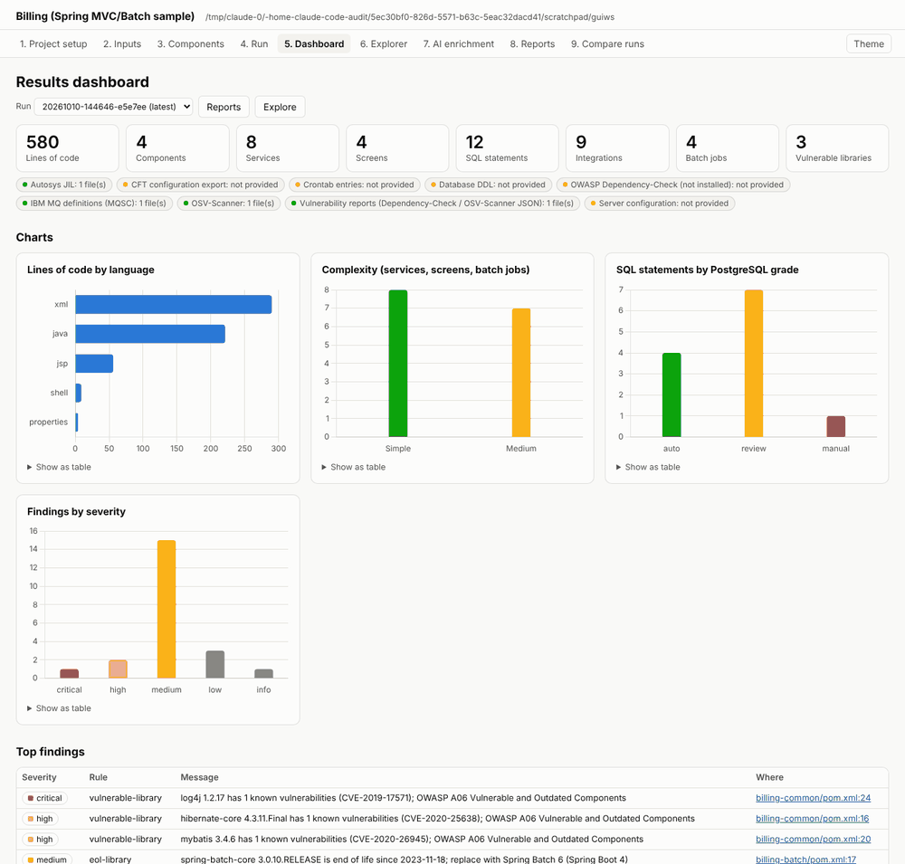
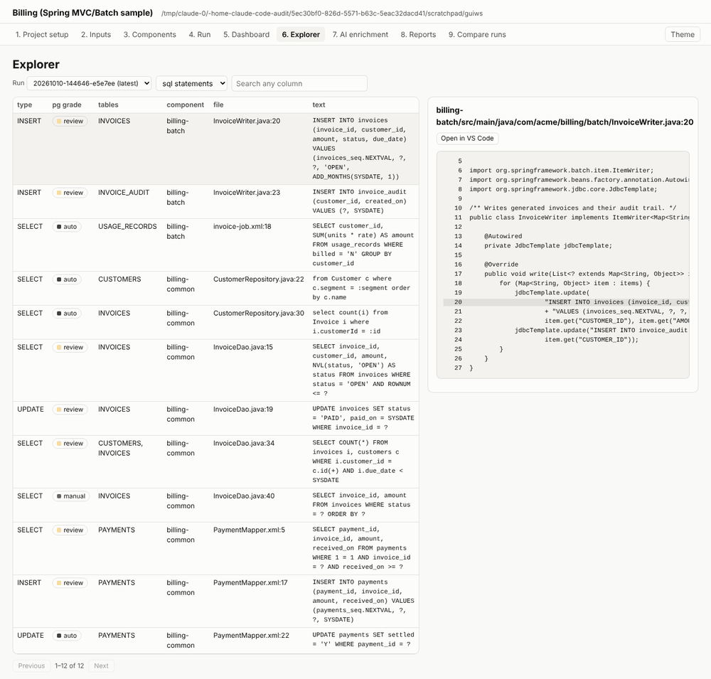

# User guide: auditing an application end to end

This walks through one audit with the GUI, using the `spring-mvc-batch-app` sample. Every step
has a CLI equivalent (shown in the margin notes) for scripts and for the Copilot agent.

Screens: 1 Project setup, 2 Inputs, 3 Components, 4 Run, 5 Dashboard, 6 Explorer,
7 AI enrichment, 8 Reports, 9 Compare runs.

## 0. Install and start

Install once (see [admin-guide.md](admin-guide.md)), then in the folder that holds, or will hold,
the application's `audit.yaml`:

```
legacy-audit serve
```

The browser opens `http://127.0.0.1:8765/`. The GUI runs on your computer only and sends nothing
anywhere. Stop it with Ctrl+C in the terminal. Options: `--workspace <folder>`, `--port <n>`,
`--no-browser`.

## 1. Project setup



- In a new folder the screen offers **Create audit.yaml**: it writes `audit.yaml`,
  `audit-overrides.yaml`, the `audit-inputs/` folders and the Copilot agent files
  (CLI: `legacy-audit init`).
- Fill in the application name, where the code is (local folders, or Git repositories with the
  *name* of an environment variable that holds a read-only token; the token itself is never
  typed or stored), the target stack and include/exclude patterns, then **Save audit.yaml**.
  Saving keeps every comment and every setting the form does not show.
- **Advanced: edit audit.yaml as text** edits the whole file; it is checked before it is saved.
- **Tools on this computer** is `legacy-audit doctor`: which optional tools are installed and what
  each one adds.

## 2. Inputs

Exports that usually arrive after the code: Autosys JIL, MQSC, CFT, DDL, crontab, server
configuration and vulnerability reports. Use **Add file** on a card (or copy files into
`audit-inputs/<kind>/`; **Open inputs folder** opens it). A missing input is a coverage gap shown
on every report, never an error. After adding one, re-run the scan.

## 3. Components

A fast pre-scan (file names only) shows the components a scan will find: one per build file or
top folder. Untick a folder to leave it out, or pick a type to override the detection, then
**Save choices**. The choices go to `audit-overrides.yaml` (`files.exclude`, `components.type`)
and are applied on every run, with a warning when one no longer matches anything.

## 4. Run



- **Re-run** analyses only files that changed since the last run; everything else comes from the
  cache. Linking, metrics, rules and totals are always recomputed.
- **Full rescan** ignores the cache.
- Progress shows each stage (inventory, analysis, linking, rules and grades, writing facts) and
  any warnings. **Cancel** stops the scan; the unfinished run is removed and the previous one
  stays the latest.
- Only one scan runs at a time per workspace, from the GUI or the CLI.
- The table lists every run: files analysed and from cache, lines of code, findings, warnings.

CLI: `legacy-audit scan` and `legacy-audit scan --full`.

## 5. Dashboard



Headline numbers of the selected run (lines of code, components, services, screens, SQL
statements, integrations, batch jobs, vulnerable libraries), which inputs were present, and
charts by language, complexity, PostgreSQL grade and finding severity. Each chart has **Show as
table**. Hover a tile to see which field of `audit-summary.json` it comes from. Top findings link
to the source line.

## 6. Explorer



Every fact kind (components, services, screens, SQL statements, batch jobs, integrations,
libraries, findings, files and more) as a searchable, paged table. Click a component to drill
down into its services, screens, SQL, batch jobs and integrations; click any other row to see its
source lines on the right (credentials masked), with **Open in VS Code** at the exact line.

CLI: `legacy-audit facts <kind> -f field=value`.

## 7. AI enrichment

The interpretation (architecture, flows, risks, plan, narratives) is written by GitHub Copilot in
VS Code with the **legacy-auditor** agent; the GUI never calls a model. This screen shows each
stage as missing, valid, stale (its inputs changed since it was written) or invalid, and the next
prompt to paste into Copilot Chat (**Copy**). After Copilot has written a stage, press
**Validate now**: numbers that differ from the scan, claims without evidence and unknown ids are
listed. See [copilot-agent.md](copilot-agent.md).

CLI: `legacy-audit validate`.

## 8. Reports

Build the technical report, the management deck (HTML) and the PowerPoint for the selected run,
then **Open** them. **Download data pack (ZIP)** gives `run.json`, every fact file (JSON, CSV,
SQLite), the SBOM and the enrichment, for Excel users or another tool.

CLI: `legacy-audit report --type tech|mgmt|pptx|all --open`.

## 9. Compare runs

Pick two runs: the table shows, per fact kind, the counts before and after and how many records
were added, removed or changed; expand a kind to see which. Typical use: after adding the
Autosys export, compare shows the new batch jobs and their links.

CLI: `legacy-audit diff previous latest`.

## Typical late-input cycle

1. Inputs: add `billing.jil` to Autosys JIL.
2. Run: **Re-run**. Only the new file is analysed.
3. Dashboard: batch jobs go up; the Autosys badge turns green.
4. AI enrichment: flows, risks, plan and narratives are now **stale**; classification is not.
   Copy `/audit-enrich stale` into Copilot Chat, then **Validate now**.
5. Reports: **Build all**.
6. Compare runs: previous against latest shows exactly what the new input added.
